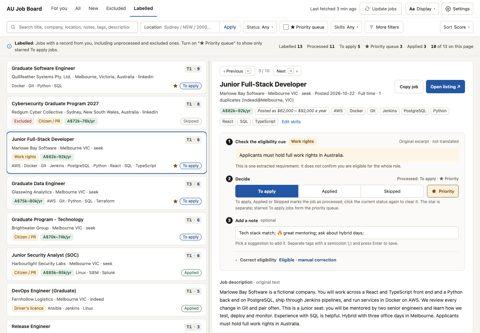
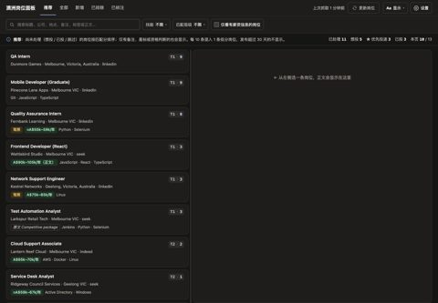
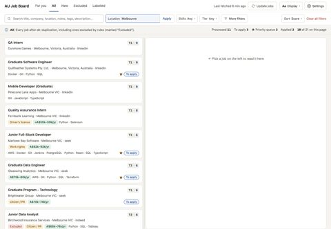
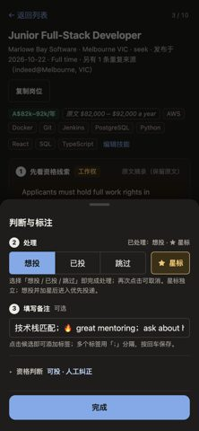
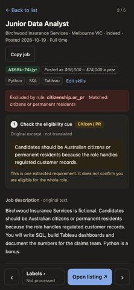
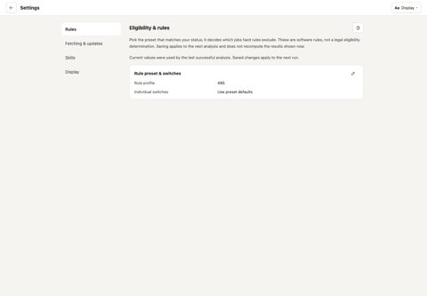
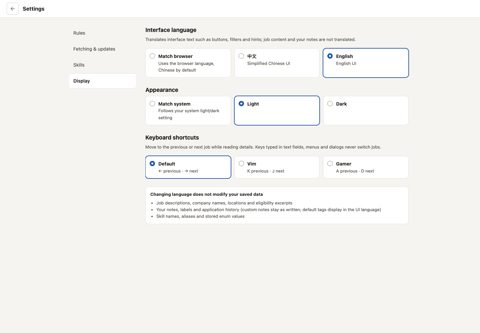
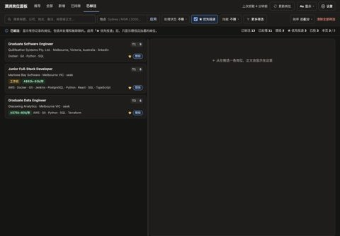
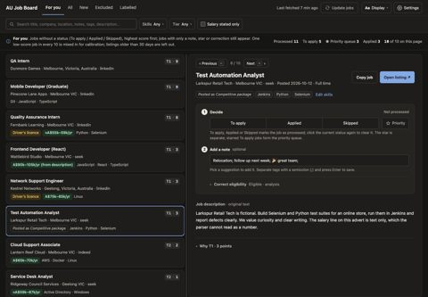

# Synthetic screenshot library

130 original PNG screenshots of the current panel running **normally**
(`jobs.cli panel`, no Demo mode or Demo banner) on a hand-written synthetic mock
of 33 postings (28 groups after de-duplication). Captured on 2026-10-23 from
`eb56c4fef036daebd48e0723acf4f7468cc2e0f3`; every image records that source
revision in `index.json`. Everything shown is fictional: no real postings,
notes, companies or personal configuration.

- Originals: [`images/`](images), direct browser screenshots, never cropped or re-encoded.
- Thumbnails: [`thumbs/`](thumbs) · 10 contact sheets: [`contact/`](contact).
- Per-image metadata (scene, language, theme, viewport, scale, capture time,
  SHA256 and bytes): [`index.json`](index.json).
- Coverage and verification limits: [`coverage.md`](coverage.md).

File names follow `<group>-<scene>-<lang>-<theme>-<device>-<viewport>.png`:
A main views, B settings, C job detail, D interactions/edge cases, and
E location search/mobile drawers. The library contains 68 desktop, 58 phone
and 4 tablet captures, with both UI languages and themes represented.

## Suggested picks

| Image | What it shows |
|---|---|
|  | Progress, independent priority star, original evidence and notes |
|  | Recommended jobs in the Chinese UI |
|  | One-box location search and the app's location matching |
|  | The phone label drawer with progress, priority and notes |
|  | Rule exclusion and quoted original-text evidence |
|  | Rule profile, per-rule settings and the last analysis configuration |
|  | Language, appearance and keyboard shortcut profiles |
|  | Starred To apply jobs, independently of note text |
|  | Default/custom/emoji note tags after saving and reloading |

## How they were produced

The original v1.0 maintainer mock builder, Playwright capture tool and contact-sheet
builder were reused with adapters for the current labels, configuration and mobile
drawers. They remain maintainer-only tools, outside the distributed product and
runtime dependencies. The previous library remains in repository history.

The public inputs are [`mock-inputs/`](mock-inputs),
[`demo/demo.jobs.json`](../../demo/demo.jobs.json), the demo config/rules/skills
and the [public configuration example](../../config.example.yaml). A fresh,
isolated root is analysed and served through the ordinary application. Legacy
uncertain labels are left uncorrected; legacy priority notes become independent
stars. This illustrates the current model without changing product logic.

All fetch sources are disabled. Two precise synthetic batch memberships and
terminal success/generation fields are seeded for the normal header display;
**they are mock display fields, not evidence of a real network fetch**. Settings
uses a complete synthetic configuration. Interaction shots save labels, notes
and one skill only into that mock root and carry `mutated_before: true` in the
index. The screenshot mock is independent of the 19-posting standalone demo and
of the larger dataset used by the [video](../demo-video/README.md).

## Browser and method

Brave/Chromium 155.0.8059.85 headless, driven by Python Playwright 1.64.1;
Pillow 10.4.0 creates separate thumbnails and contact sheets. Viewports are
CSS-pixel emulations: desktop 1440x1000 @1x, phone 390x844 @2x touch, tablet
768x1024 @2x. These are not physical-device checks. Language and theme use the
panel's own cookies. Animations remain enabled; each shot waits for fonts,
network idle and a settle delay. Originals are direct browser output, with
no drawn overlays, cropping or image editing.
